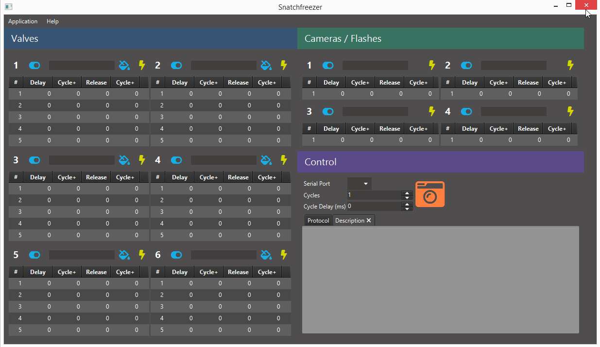
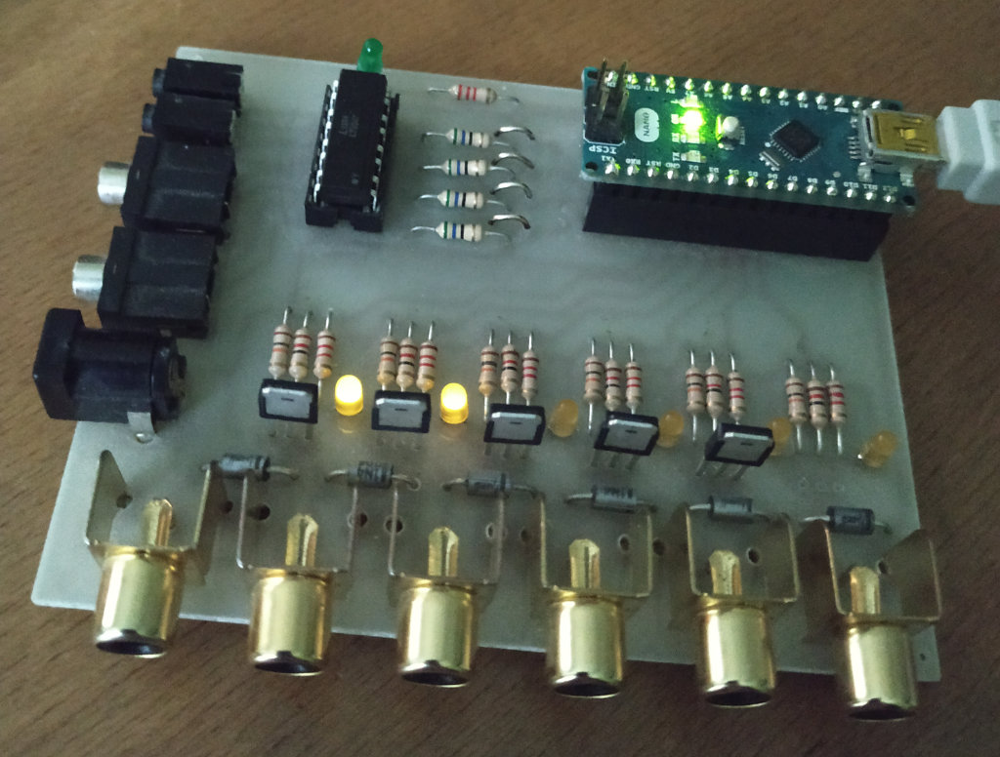
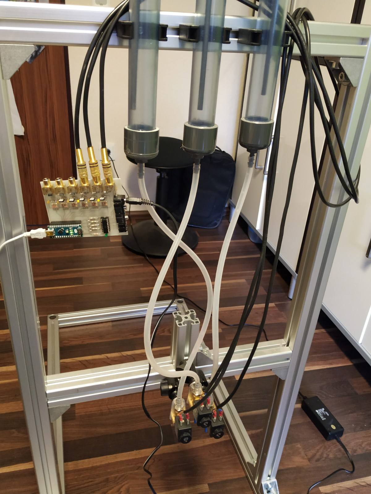
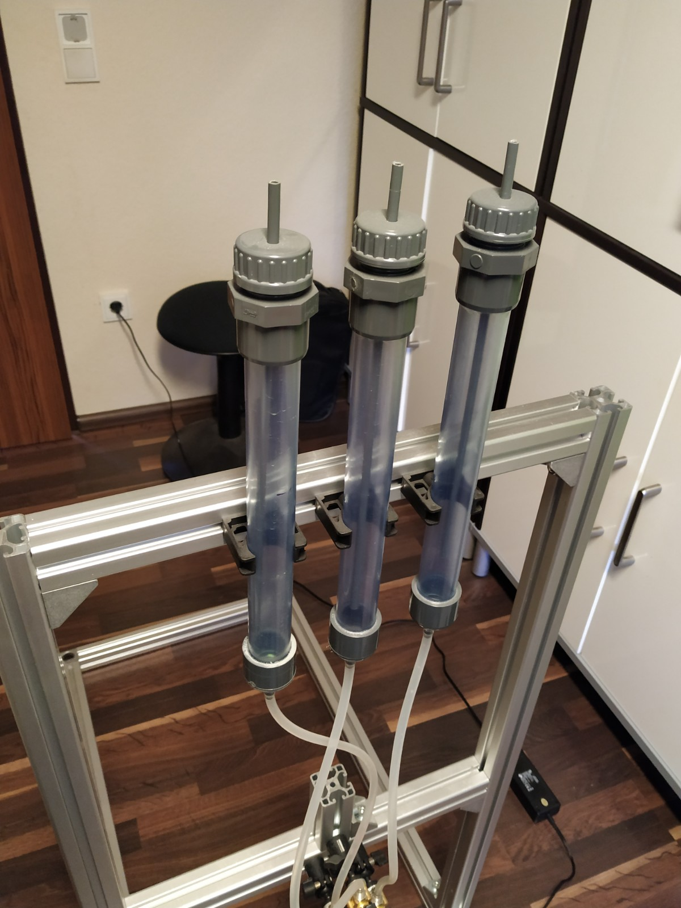
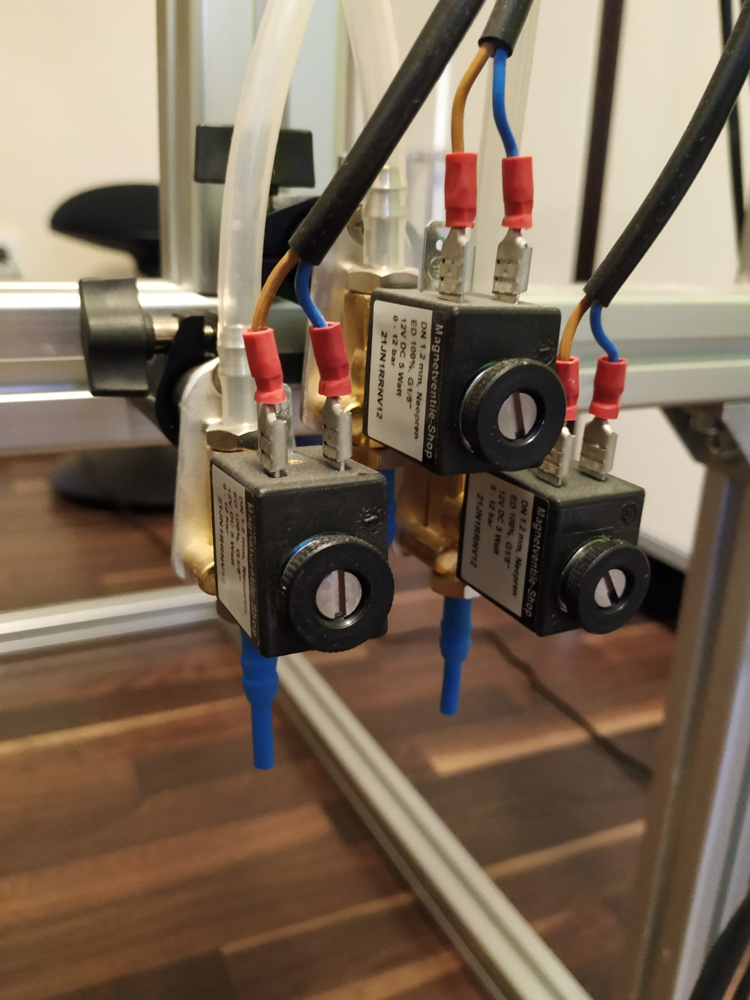

# SnatchFreezer (Beta)
SnatchFreezer is a project for Highspeed photography

Runs on Windows, Mac and Linux

This project also contains all required software and PCB layouts including:
- Rust - Controller Frontend (`frontend`)
- Arduino Sketch
- Eagle PCB

Current Features:
- Connect up to six 12V driven valves or similar devices directly with 5 timing entries each.
- Connect up to two camera and/or flashes.

- Load and Save your settings
- Remembers the last project, serial port and window size (`~/.snatchfreezer/config.json`)
- Changed fields are marked until the project is saved, unsaved changes show a `*` in the window title
- Test all channels separately or altogether for 100ms.
- Toggle flushing all or single siphons from UI.
- Set amount of cycle loops
- Set delay time after each cycle loop.
- Describe each channel and/or the whole project
- Presets for TaT and Crown
- View log protocol
- Minimum valve delay/release time combination: 0,015 s -> 15 ms -> 15000 us / 0,004 s -> 4 ms -> 4000 us

Known Bugs:
- Data transfer sometimes hangs


Future plans:
- WLAN and/or Bluetooth Module
- Rest Api
- Android Client


# Build the Frontend
The frontend uses the [drazui](https://github.com/guidobonerz/drazui) UI library, which cargo fetches from GitHub
automatically. The exact commit is pinned in `frontend/Cargo.lock`; run `cargo update -p drazui` to pull a newer one.

```
cd frontend
cargo run --release
```

# Controller Firmware
Flash `arduino/Snatchfreezer` to the Arduino Nano. Frontend and firmware must match: the Rust frontend needs firmware 2.x,
the serial protocol is described in `arduino/Snatchfreezer/Protocol.h`.

# Download latest Frontend
Prebuilt binaries for Windows, Linux and macOS are attached to the
[releases](https://github.com/guidobonerz/snatchfreezer/releases). They are built by GitHub Actions whenever a version tag
(e.g. `v2.0.0`) is pushed.

After unpacking, the file may have to be marked as executable before it starts:

- **Linux**
  ```
  chmod +x snatchfreezer
  ./snatchfreezer
  ```
- **macOS** - set the executable flag and remove the download quarantine, otherwise Gatekeeper blocks the unsigned app
  ```
  chmod +x snatchfreezer
  xattr -d com.apple.quarantine snatchfreezer
  ./snatchfreezer
  ```
- **Windows** - there is no executable flag, but downloaded files are blocked. Right click `snatchfreezer.exe` ->
  Properties -> check *Unblock* (or run `Unblock-File .\snatchfreezer.exe` in PowerShell). If SmartScreen appears,
  choose *More info* -> *Run anyway*.

## Shot 1

## Shot 2


## Controller View


## PCB


## Frame


## Siphons


## Valves

